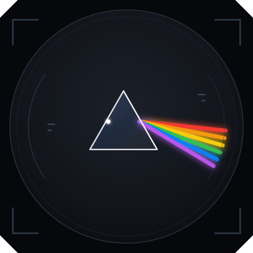

<div align="center">


<br />
<br />

**Um feixe entra. Seis saem.**<br />
Workspace desktop local-first para rodar vários agentes de código de CLI em paralelo,
cada um num terminal PTY vivo, direto na pasta do seu projeto.

<br />


<br />
<br />


</div>

---

## O que é

Você abre uma pasta (qualquer pasta, git ou não) e o Melinna vira o seu painel de agentes: cada terminal roda o agente escolhido direto naquela pasta, então ele enxerga os seus arquivos e o histórico de conversas do agente para aquele projeto. Cada execução é um terminal real e interativo, não um log morto: você conversa com cada agente no seu painel e acompanha vários ao mesmo tempo.

Sessões criadas por versões anteriores, que rodavam num git worktree isolado, continuam funcionando como antes.

## Funcionalidades da primeira versão

| | Funcionalidade | |
|:-:|---|---|
| 🟥 | **Terminal PTY vivo por execução** | prompts interativos, cores e redesenho de tela funcionam; a conversa continua sem relançar |
| 🟧 | **Scrollback persistido e reanexação** | feche e reabra o app: os agentes continuam rodando e os painéis voltam com o histórico |
| 🟨 | **Direto na pasta** | qualquer pasta vira workspace; o terminal roda nela, com o histórico do agente daquele projeto |
| 🟩 | **Grade de painéis redimensionável** | divisórias arrastáveis entre os painéis e na barra lateral, arrastar e soltar para reordenar |
| 🟫 | **Workspace com vários projetos** | um workspace reúne várias pastas, com uma principal onde o terminal abre; o agente recebe as demais (`--add-dir` no Claude Code) e o explorador mostra uma raiz por pasta |
| ⬛ | **Imagens no terminal** | cole um print (Ctrl+V), solte arquivos no painel ou use o clipe: uma prévia confirma e a referência da imagem vai para o prompt do agente, sem Enter |
| 🟦 | **Sessões e workspaces** | "+" para abrir mais um terminal escolhendo a IA; remover sessão ou workspace sem apagar a pasta |
| ⬜ | **Biblioteca de prompts** | Ctrl+Shift+P: guarde os prompts que você repete, com variáveis (`{{arquivo}}`; `{{pasta}}`, `{{workspace}}` e `{{data}}` se preenchem sozinhas), envie para um terminal ou para várias sessões de uma vez, ou enfileire para a sessão receber quando ficar ociosa |
| 🟪 | **Editor de arquivos** | aba Arquivos com editor de código no comportamento do IntelliJ: ir para linha (`120:5`), estrutura do arquivo, próxima ocorrência e vários cursores, buscar no projeto com prévia, substituir no arquivo, comentar e reindentar, fechar outras/todas e reabrir aba fechada, editor dividido à direita ou abaixo com o mesmo arquivo nos dois lados e marcas do git na margem com "Reverter este trecho". Nada é gravado sem o salvar explícito (Ctrl+S ou "Salvar todos") |
| 🟧 | **Configurações de execução** | janela no modelo do IntelliJ (árvore por ferramenta e pasta, Aplicar/OK/Cancelar) com configurações salvas por workspace: npm/pnpm/yarn, Maven, Gradle, Compose ou um programa, com argumentos, variáveis de ambiente (valores com cara de segredo mascarados), opções do runtime (`NODE_OPTIONS`, `MAVEN_OPTS`, `GRADLE_OPTS`), "antes de lançar" e várias instâncias. O seletor da barra superior lista só as salvas e cria uma a partir de um script detectado; o comando roda num terminal do app, sem shell, e continua vivo ao fechar a janela |
| 🟦 | **Mapas de atalhos** | Windows, IntelliJ, Eclipse ou VS Code: a troca vale na hora e funciona com o terminal ou o editor em foco; as ações do editor (ir para linha, estrutura, próxima ocorrência, buscar no projeto, comentar…) só valem com o editor em foco, e Ctrl+C, Ctrl+D, Ctrl+Z, Ctrl+B e as setas ficam sempre com o terminal |
| 🟥 | **Git na interface** | barra de ferramentas vertical à esquerda (Workspaces, Arquivos, Commit; Alt+1/Alt+2/Alt+0 fora do terminal; clicar no ícone ativo recolhe); painel Commit fixo com a árvore "Changes" e "Unversioned Files" agrupada por repositório do workspace ativo (branch de cada um), caixas de seleção, diff ao lado, Amend, "Commit" e "Commit and Push…" em vários repositórios de uma vez, reverter e conflitos de merge; na barra superior o seletor do workspace ativo e o menu da branch (trocar, criar, mesclar, fetch, pull, push com progresso e cancelamento, histórico; fetch/pull de todos os repositórios). Operações que podem perder trabalho pedem confirmação; as credenciais ficam com o git |

Agentes iniciais: Claude Code, Codex CLI e Gemini CLI, mais os shells do sistema. Os agentes vivem num catálogo declarativo: acrescentar um agente é acrescentar uma entrada, sem mexer no motor.

## Princípios

- **Agente é processo, não biblioteca.** O app lança executáveis num PTY; nenhum SDK de agente é importado.
- **Isolamento por worktree.** Todo trabalho acontece numa branch e num worktree próprios.
- **O PTY é a fonte da verdade.** O processo do agente sobrevive à interface; fechar o app não perde o scrollback.
- **Núcleo independente da camada de desktop.** A orquestração não importa o framework de desktop, e um teste reprova quem tentar.
- **Sem shell no lançamento.** Argumentos vindos do catálogo e do texto do usuário nunca passam por `cmd.exe` ou `sh -c`.
- **Código e marca próprios.** Ideias de produto podem ter inspiração externa; código, nome, logo e assets são exclusivamente deste projeto.

A lista completa está na [constitution](.specify/memory/constitution.md).

## Status

A primeira fatia está implementada (feature 001), especificada com o [GitHub Spec Kit](https://github.com/github/spec-kit). Windows 10 1809+ é a plataforma validada; o Linux gera um AppImage (veja [Empacotamento para Linux](#empacotamento-para-linux)), ainda em validação; o macOS compila. O instalador ainda não é assinado.

| Artefato | Caminho |
|---|---|
| Constitution | [`.specify/memory/constitution.md`](.specify/memory/constitution.md) |
| Spec da primeira fatia | [`specs/001-workspace-agentes-paralelos/spec.md`](specs/001-workspace-agentes-paralelos/spec.md) |
| Plano técnico | [`specs/001-workspace-agentes-paralelos/plan.md`](specs/001-workspace-agentes-paralelos/plan.md) |
| Contratos | [`specs/001-workspace-agentes-paralelos/contracts/`](specs/001-workspace-agentes-paralelos/contracts/) |
| Tasks (165) | [`specs/001-workspace-agentes-paralelos/tasks.md`](specs/001-workspace-agentes-paralelos/tasks.md) |

## Stack

Electron 44 · node-pty 1.1 (ConPTY no Windows) · @xterm/xterm 6 · React 19 · TypeScript estrito · Vitest · Playwright

## Desenvolvimento

Pré-requisitos (Windows):

- Node 24 e npm
- Git 2.30+ no PATH
- Visual Studio Build Tools com "Desenvolvimento para desktop com C++" e Python 3, para recompilar o node-pty para o Electron
- Opcional: `claude`, `codex` e `gemini` instalados e autenticados

Comandos:

| Comando | O que faz |
|---|---|
| `npm install` | instala as dependências e recompila o node-pty |
| `npm run dev` | abre o app em modo de desenvolvimento |
| `npm run test:unit` | testes unitários e de componentes |
| `npm run test:integration` | testes com git e PTY reais, sob o Node do Electron |
| `npm run test:arch` | fronteiras entre as camadas |
| `npm run test:perf` | metas de desempenho (lançamento, eco, reanexação) |
| `npm run test:e2e` | fluxos ponta a ponta com o Playwright |
| `npm run icons` | gera os ícones a partir de `docs/brand/logo.svg` |
| `npm run dist` | gera o instalador da plataforma atual em `dist/`: `melinna.exe` no Windows, `melinna.AppImage` no Linux |

Detalhes e validação manual no [quickstart](specs/001-workspace-agentes-paralelos/quickstart.md).

### Instaladores pelo GitHub Actions

O workflow [`build.yml`](.github/workflows/build.yml) gera os instaladores nos servidores do GitHub, sem precisar de Linux na sua máquina: aba **Actions** → **Gerar instaladores** → **Run workflow**. Em cerca de 10 minutos, a página da execução mostra para baixar `melinna-windows` (`melinna.exe`) e `melinna-linux` (`melinna-linux-x64.tar.gz` e `melinna.AppImage`). Também roda sozinho ao enviar uma tag `v*`.

### Empacotamento para Linux

O pacote para Linux precisa ser gerado num Linux (ou no WSL2): o node-pty não traz binário pronto para Linux e é compilado no `npm ci`. Clone o projeto dentro do Linux, sem reaproveitar o `node_modules` do Windows. Precisa do Node 24.

```bash
sudo apt install -y build-essential python3 git
git clone https://github.com/Davii-code/melinna.git ~/melinna && cd ~/melinna
npm ci
npm run dist:linux
```

Saem dois arquivos em `dist/`:

| Arquivo | Para quem |
|---|---|
| `melinna-linux-x64.tar.gz` | pacote para distribuir: descompactar e rodar `./install.sh` (qualquer distribuição x64, sem sudo, sem FUSE) |
| `melinna.AppImage` | executável único; precisa de `libfuse2` em distribuições recentes |

Instalação a partir do pacote:

```bash
tar -xzf melinna-linux-x64.tar.gz && cd melinna-linux-x64 && ./install.sh
```

O `install.sh` copia o app para `~/.local/opt/melinna`, cria os comandos `melinna` e `melinna-uninstall` em `~/.local/bin` e o atalho no menu de aplicativos. No Ubuntu 23.10+, que restringe o sandbox do Electron, ele oferece instalar um perfil do AppArmor (sudo uma vez) ou, se recusado, abre o app com `--no-sandbox`. Os scripts ficam em [`scripts/linux/`](scripts/linux/); `npm run test:linux-install` testa a instalação e a remoção num HOME temporário, sem sudo.

### Independência de código e de marca

O produto se inspira em ideias de interface de outro projeto público. Neste repositório não se copia, transcreve nem parafraseia código de terceiros, e não se usa nome, logo, ícones ou qualquer asset de outro projeto. Toda a interface e toda a marca são próprias; a regra completa é o Princípio IX da [constitution](.specify/memory/constitution.md).

## Identidade visual



Um feixe de luz branco entra num prisma e sai decomposto em seis faixas coloridas: uma tarefa atacada por vários agentes em paralelo. Tema escuro como primário, sobre `#07080b`, com acento `#4f8cff`.

<br clear="left" />


Assets em [`docs/brand/`](docs/brand/).

## Autor

Feito por [@Davii-code](https://github.com/Davii-code).
